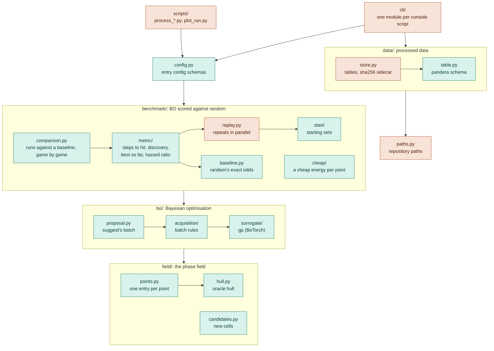
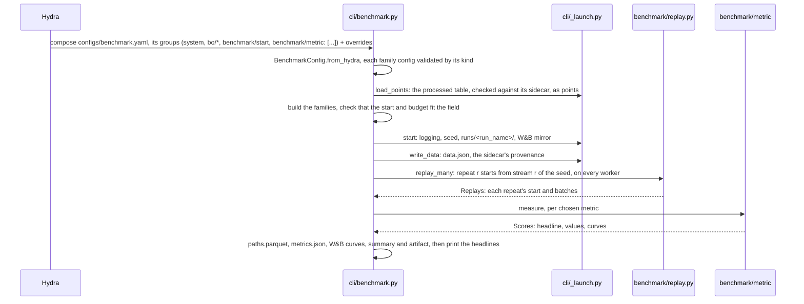

# Contributing

How phasebo is built and how to change it. Using it: [README.md](README.md). Conventions that apply to
every project, with their reasons: [CONVENTIONS.md](CONVENTIONS.md) (a read-only copy of the guide; `copier update`
refreshes it). The `conventions-reviewer` subagent in `.claude/agents/` checks a branch or the repo against it;
`descriptions-judge` checks each config description and YAML comment against DOC-7 and the code.

## Architecture



An arrow means "imports"; teal modules decide (same input, same output), rust ones act on files or processes.
Every layer may import the ones below it and `nuikit`. `phasebo` holds this project's code, split by domain:

- `data/` is processed data: the canonical table (`table.py`, pure) and its files with their sidecars (`store.py`).
- `field/` is the phase field: the oracle hull, one entry per point (its lowest cell, its `pymatgen` phase diagram
  coordinates, its energy above the hull, whether it is a reference or a target), and the candidates: the
  smallest charge-balanced cell of each point not computed yet, which `phasebo-generate` lists without any BO.
- `bo/` is the method: two families decide how BO models the points (`surrogate`) and picks a batch
  (`acquisition`), and `proposal.py` drives them for `phasebo-suggest`.
- `benchmark/` scores the method: `replay.py` replays BO over the computed points from many starting sets (the
  `start` family), and the `metric` family measures the replays next to random picking's exact odds
  (`baseline.py`). A `cheap` source gives every repeat each point's cheap energy before BO picks, drawn from the
  repeat's own stream; the commands hand the replay its draw, so `replay.py` never imports the family. A run
  computes several metrics at once (FAM-4's `multiple`). `comparison.py` checks that runs played the same games
  and asks each metric how a run differs from a baseline.

None of them writes a file; the commands in `cli/` do. Figures are not part of a run:
`uv run --group notebooks scripts/plot_run.py runs/<run_name>` draws the hull map and each metric's curves into the
run directory (see Deviations).

`nuikit` is the machinery every project built from the template shares: what schemas and families build on, and
what an entry point sets up before it runs. Copier writes it; fixes go upstream and arrive with `copier update`.

Dependencies point down: `cli` > `config` > `benchmark` > `bo` > `field` | `data` > `paths`, and any layer may import
`nuikit`. Inside `benchmark`, metrics import the replays, which import the starting sets; inside `bo`, `proposal`
imports the batch rules, which import the surrogate; inside `field`, `points` imports `hull`; inside `data`,
`store` imports `table`; the cheap sources import nothing else in `benchmark`. Scripts sit outside the package and
may import any of it. The import-linter contracts in `pyproject.toml` enforce every one of these orders and keep
`nuikit` from importing `phasebo`. The layers contracts are exhaustive, so a new module fails `make check` until it
is placed.

### A command



## Repository layout

```text
configs/                  Hydra YAML; generated files say so in a leading comment line
  suggest.yaml            entry configs: pick the mirror, the groups and Hydra's settings
  benchmark.yaml
  generate.yaml
  data.yaml               composed by phasebo-data once per phase field
  defaults/               every setting of each entry config with its default (generated)
  bo/surrogate/           gp.yaml (generated), paper.yaml (preset: the paper's fitted noise)
  bo/acquisition/         qlogei.yaml, ts.yaml, random.yaml, screen.yaml (generated)
  benchmark/start/        random.yaml (generated)
  benchmark/metric/       one file per metric, selected together (generated)
  benchmark/cheap/        table.yaml, noisy.yaml (generated); none is selected by default
  system/                 phase fields: processed table, elements, candidate space
  hydra/default.yaml      Hydra writes nothing; the app writes runs/
data/                     tracked (see Deviations)
  raw/                    datasets as published, never edited
  processed/              one table per phase field and the sidecar pinning it, written by scripts/process_*.py
src/phasebo/
  cli/                    one module per console script, plus _launch.py, their shared start-up
  config.py               entry config schemas + GENERATED (files `make configs` writes)
  paths.py                repository paths, from the .project-root marker
  data/                   processed data
    table.py              the canonical table: its pandera schema; build, clean, render, parse (pure)
    store.py              tables on disk: write with a pydantic sidecar, check, load
  field/                  the phase field
    hull.py               energies above the oracle hull
    points.py             one entry per point: lowest cell, coordinates, energy, role
    candidates.py         charge-balanced cells; the smallest at each new point
  bo/                     Bayesian optimisation
    surrogate/            family: models of the energy above the hull
    acquisition/          family: rules that pick the next batch
    proposal.py           suggest's next batch and the prediction at every candidate point
  benchmark/              BO scored against random picking
    start/                family: a replay's starting set
    cheap/                family: each point's cheap energy, known before BO picks
    metric/               family, several per run: what the replays achieved
    replay.py             one replay, and many in parallel (Replays)
    baseline.py           random picking's exact odds
    comparison.py         runs against a baseline: the pairing check, then each metric's contrast
src/nuikit/               copied from the conventions template: config, configgen, registry, errors, logging,
                          runs, seeding
tests/                    mirrors src/; tests/nuikit/ comes with the template
  conftest.py             in-process fakes of the BO families
  test_invariants.py      configs compose and are fresh, kinds build, import layers hold, processed tables match
  phasebo/conftest.py     a synthetic Li-Sn-S-Cl phase field, processed as a script would
  phasebo/benchmark/conftest.py  replays built by hand, and 2000 of random picking
  integration/            end to end, `-m integration`
scripts/                  exploratory or one-time runnables, never imported; rerun ones become cli/ commands
  process_<source>.py     one per raw source: writes its processed table and sidecar
  plot_run.py             a run's figures: hull map, each metric's curves
  wandb_workspace.py      saves the project's "Benchmarks" view in W&B, or with --report a shareable report
notebooks/                exploration only, outputs stripped; reference/ for third-party notebooks
runs/                     gitignored
```

## Families

A family is a concept with several implementations chosen by a config `kind`. Each is a Hydra group: `make configs`
writes one file per kind there, the option that `<group>=<kind>` selects, and a hand-written preset names a variant
of a kind (`bo/surrogate=paper`). A `multiple` family is selected as a list, each kind at its own key.

| family | kinds | chosen by |
|---|---|---|
| `bo/surrogate` | `gp`: BoTorch single-task GP, Matern 1/2, 3/2, 5/2 or RBF, fixed or fitted noise | `bo/surrogate=gp` (default), `bo/surrogate=paper` |
| `bo/acquisition` | `qlogei`, `ts`, `random`, `screen`; `random` and `screen` have `needs_model = False`, so the replay does not fit the GP; `screen` has `needs_cheap = True` and picks the lowest cheap energies | `bo/acquisition=<kind>` |
| `benchmark/start` | `random`: explored points off the hull, from the repeat's own stream | `benchmark/start=random` |
| `benchmark/cheap` | `table`: another fidelity of the processed table; `noisy`: the modelled total energies with random and smooth errors, the hull rebuilt, per repeat | `benchmark/cheap=<kind>`; none by default, and a kind that `needs_cheap` then refuses to run |
| `benchmark/metric` (multiple) | `steps_to_hit`, `discovery`, `best_so_far`, `hazard_ratio` | `benchmark/metric=[...]`, all four by default |

```text
src/phasebo/<domain>/<family>/
  base.py        <Family> (attrs ABC), <Family>Config, <Family>Factory (config_group = "<domain>/<family>")
  items/
    __init__.py  import_submodules(__name__)
    <kind>.py    @<Family>Factory.register("<kind>") above @define
```

`<Family>Factory.from_config({"kind": ..., ...})` validates against the item's config and builds it. A metric
returns a `Score`: a headline the command prints, values for `metrics.json` and the W&B summary, and curves over
`Replays.evaluations`. A value or curve `x` comes with `x/random`, random picking's exact value: `metrics.json`
and `plot_run.py` keep it, while W&B gets BO's alone, since there a run of the random batch rule is the
comparison. Each metric also sets `reading`, plain words on its curves that the W&B view prints above them; a
test checks that every registered metric has one. A metric's `contrast(base, run)` says how a run differs from a
baseline whose repeat r is the same game: a paired difference per game with a bootstrap interval (`pair`), or a
ratio from one joint fit, as the hazard ratio does.

## Extending

| to add | create | and |
|---|---|---|
| a phase field | its raw file in `data/raw/`, `configs/system/<name>.yaml` and `scripts/process_<source>.py` | run the script once, commit the table and sidecar; run commands with `system=<name>` |
| a kind of a family | `src/phasebo/<domain>/<family>/items/<kind>.py` | `make configs`; choose it with `<domain>/<family>=<kind>` |
| a metric | `src/phasebo/benchmark/metric/items/<kind>.py`, comparing with `baseline.py`, with its `reading` and `contrast` | `make configs`; add it to the list in `configs/benchmark.yaml`; rerun `scripts/wandb_workspace.py --url <view>` and `scripts/wandb_workspace.py --report --url <report>` |
| a variant of a kind | a preset `configs/<domain>/<family>/<name>.yaml` whose defaults list names the kind; never a kind's name | choose it with `<domain>/<family>=<name>` |
| a family | `src/phasebo/<domain>/<family>/base.py` + `items/`, a `_by_kind` (or, if `multiple`, `_by_kinds`) field type in `config.py` and a field of it, a group in the entry configs | place it in its domain's import-linter `layers`; `make configs` |
| an entry config | a schema in `config.py` listed in `GENERATED` as `defaults/<command>.yaml`, and `configs/<command>.yaml` composing it | a `cli/<command>.py` and a console script |
| a setting | a field with a default on the schema, described only if its name leaves something open (DOC-7) | `make configs` |

## Deviations

- **`data/` is tracked** (LAY-4, GIT-5 and RUN-6 say gitignored). The raw datasets are small and published with the paper, and every
  number in the docs must trace back to the exact file; pre-commit's whitespace fixers leave them byte for byte.
  Processed tables and their sidecars are committed too, so a script's output shows in review row by row;
  `make data`, the invariant tests and the commands fail when a table was edited, or its script or a raw file
  changed, since the table was written.
- **Processed tables are CSV** (RUN-7 prefers parquet for derived tables): CSV diffs line by line in review.
- **Notebooks are marimo files** (RUN-5 describes `.ipynb`), installed with the `notebooks` dependency group. They
  are plain Python with no stored outputs, so nbstripout has nothing to strip; `__marimo__/` caches are gitignored.
- **`cli/_launch.py`** is a module in `cli/` that is not a console script (LAY-7). It holds what the commands share
  and what needs the config schemas, so it sits in the only layer above `config`: start-up, loading the processed
  table and its points, reading the candidate files, and loading benchmark runs back for `phasebo-compare`.
- **`scripts/plot_run.py` is rerun for any run** (LAY-7 makes such a script a command): figures are a developer
  aid, not part of a run or of the README, and `tracker=wandb` shows a benchmark's curves. It has no tests; it
  refuses a run whose processed table has changed since.
- **`scripts/wandb_workspace.py` is rerun after a metric is added or the benchmark setup changes** (LAY-7 makes
  such a script a command): it saves the project's "Benchmarks" view in W&B, or with `--report` a report of the
  same content to share outside the project, a developer aid that is not part of a run, whose "How to read" note
  quotes the newest run's repeats, batches and field; `--url <view or report>` rewrites one in place. A report is
  saved to the project, for whoever can see the project; the script makes no share link, which is a person's
  decision, made in W&B. It has no tests. Its packages are the `wandb` dependency group, installed by default so that
  pyright checks it.
- **GP priors are fixed** (CFG-7): every Matern kernel keeps BoTorch's pre-0.12 Matern 5/2 priors, Gamma(3, 6)
  on each lengthscale and Gamma(2, 0.15) on the outputscale, so `kernel` changes only nu. For `matern52` they
  reproduce the paper's GP; for `matern12` and `matern32` they are a choice, made to change one thing at a time.
- **BoTorch draws from torch's global generator** (RUN-2 asks for an explicit one): fitting a GP, qLogEI's MC
  sampler and Thompson sampling take no generator. `seed_everything` seeds it once per run, and a benchmark seeds
  it again in each repeat from that repeat's stream, so runs repeat whatever `benchmark.workers` is; starting sets
  and random acquisition take `np.random.Generator`s from the same streams.

## Tests

```bash
make test               # unit tests, a few seconds
make test-integration   # end to end, behind the integration marker
```

Fakes, not mocks (`unittest.mock` is banned by ruff). Each case covers a distinct behaviour; child processes and
servers only for what cannot be measured in process. The commands are tested through their `run(cfg, runs_dir=...)`
functions; `tests/test_invariants.py` covers their Hydra configs.

## Commits

Conventional Commits with the standard types (`feat fix docs refactor test build ci perf style chore revert`), an
optional scope, a lowercase imperative subject: one line, no articles, no body or trailers. Short-lived `<type>/<slug>`
branches, squash-merged. The commit-msg hooks check all of it. PR descriptions follow
`.github/pull_request_template.md`; `make github`, run once per repo, makes the squash commit the PR title alone.
