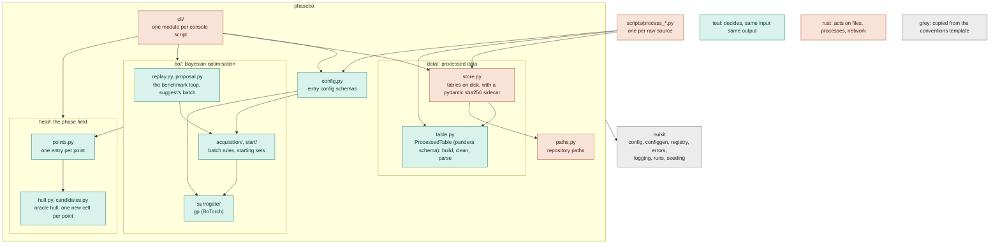

# Contributing

How phasebo is built and how to change it. Using it: [README.md](README.md). Conventions that apply to every project,
with their reasons: [CONVENTIONS.md](CONVENTIONS.md) (a read-only copy of the guide; `copier update` refreshes it).
The `conventions-reviewer` subagent in `.claude/agents/` checks a branch or the repo against it.

## Architecture



`phasebo` holds this project's code, split by domain:

- `data/` is processed data: the canonical table (`table.py`, pure) and its files with their sidecars (`store.py`).
- `field/` is the phase field: the oracle hull, one entry per point (its lowest cell, its `pymatgen` phase diagram
  coordinates, its energy above the hull, whether it is a reference or a target), and the candidates: the
  smallest charge-balanced cell of each point not computed yet, which `phasebo-generate` lists without any BO.
- `bo/` is the search: three families decide how BO models the points (`surrogate`), picks a batch
  (`acquisition`) and starts a benchmark (`start`); `replay.py` and `proposal.py` drive them for the two BO
  commands. It writes no file; the commands in `cli/` do.

Figures are not part of a run: `uv run --group notebooks scripts/plot_run.py runs/<run_name>` draws the hull map
and a benchmark's convergence into the run directory (see Deviations).

`nuikit` is the machinery every project built from the template shares: what schemas and families build on, and
what an entry point sets up before it runs. Copier writes it; fixes go upstream and arrive with `copier update`.

Dependencies point down: `cli` > `config` > `bo` > `field` | `data` > `paths`, and any layer may import `nuikit`.
Inside `bo`, the loops import the families, and the batch rules import the surrogate; inside `field`,
`points` imports `hull`; inside `data`, `store` imports `table`. Scripts sit outside the package and may import any
of it. The import-linter contracts in `pyproject.toml` enforce every one of these orders and keep `nuikit` from
importing `phasebo`. The layers contracts are exhaustive, so a new module fails `make check` until it is placed.

### A command

```mermaid
sequenceDiagram
    participant H as Hydra
    participant C as cli/benchmark.py
    participant L as cli/_launch.py
    participant R as bo/replay.py
    H->>C: compose configs/benchmark.yaml, its groups (system, bo/surrogate, bo/acquisition, bo/start) + overrides
    C->>C: BenchmarkConfig.from_hydra, each family config validated by its kind
    C->>L: load_points: the processed table, checked against its sidecar, as points
    C->>C: build the start, surrogate and acquisition from their configs
    C->>L: start: logging, seed (the run's generator), runs/<run_name>/, W&B mirror
    C->>L: write_data: data.json, the sidecar's provenance
    C->>R: replay: the starting set, then batches; the GP is fitted only if the acquisition needs it
    R-->>C: the path
    C->>C: bo_path.csv in the run directory
```

## Repository layout

```text
configs/                  Hydra YAML; generated files say so in their first line
  suggest.yaml            entry configs: pick the mirror, the groups and Hydra's settings
  benchmark.yaml
  generate.yaml
  data.yaml               composed by phasebo-data once per phase field
  defaults/               every setting of each entry config with its default (generated)
  bo/surrogate/           gp.yaml (generated), paper.yaml (preset: the paper's fitted noise)
  bo/acquisition/         qlogei.yaml, ts.yaml, random.yaml (generated)
  bo/start/               random.yaml (generated)
  system/                 phase fields: processed table, elements, candidate space
  hydra/default.yaml      Hydra writes nothing; the app writes runs/
data/                     tracked (see Deviations)
  raw/                    datasets as published, never edited
  processed/              one table per phase field and the sidecar pinning it, written by scripts/process_*.py
src/phasebo/
  cli/                    one module per console script, plus _launch.py, their shared start-up
  config.py               entry config schemas + GENERATED (files `make configs` writes)
  paths.py                repository paths, from the .project-root marker
  data/                   processed data
    table.py              the canonical table: its pandera schema; build, clean, render, parse (pure)
    store.py              tables on disk: write with a pydantic sidecar, check, load
  field/                  the phase field
    hull.py               energies above the oracle hull
    points.py             one entry per point: lowest cell, coordinates, energy, role
    candidates.py         charge-balanced cells; the smallest at each new point
  bo/                     Bayesian optimisation
    surrogate/            family: models of the energy above the hull
    acquisition/          family: rules that pick the next batch
    start/                family: a benchmark's starting set
    replay.py             the benchmark loop
    proposal.py           suggest's next batch and the prediction at every candidate point
src/nuikit/               copied from the conventions template: config, configgen, registry, errors, logging,
                          runs, seeding
tests/                    mirrors src/; tests/nuikit/ comes with the template
  test_invariants.py      configs compose and are fresh, kinds build, import layers hold, processed tables match
  phasebo/conftest.py     a synthetic Li-Sn-S-Cl phase field, processed as a script would
  integration/            end to end, `-m integration`
scripts/                  exploratory or one-time runnables, never imported; rerun ones become cli/ commands
  process_<source>.py     one per raw source: writes its processed table and sidecar
  plot_run.py             a run's figures: hull map, convergence
notebooks/                exploration only, outputs stripped; reference/ for third-party notebooks
runs/                     gitignored
```

## Families

A family is a concept with several implementations chosen by a config `kind`. Each is a Hydra group under
`configs/bo/`: `make configs` writes one file per kind there, the option that `bo/<family>=<kind>` selects, and a
hand-written preset names a variant of a kind (`bo/surrogate=paper`).

| family | kinds | chosen by |
|---|---|---|
| `bo/surrogate` | `gp`: BoTorch single-task GP, Matern 1/2, 3/2, 5/2 or RBF, fixed or fitted noise | `bo/surrogate=gp` (default), `bo/surrogate=paper` |
| `bo/acquisition` | `qlogei`, `ts`, `random`; `random` has `needs_model = False`, so the replay does not fit the GP | `bo/acquisition=<kind>` |
| `bo/start` | `random`: explored points off the hull, drawn with the run's generator | `bo/start=random` |

```text
src/phasebo/bo/<family>/
  base.py        <Family> (attrs ABC), <Family>Config, <Family>Factory (config_group = "bo/<family>")
  items/
    __init__.py  import_submodules(__name__)
    <kind>.py    @<Family>Factory.register("<kind>") above @define
```

`<Family>Factory.from_config({"kind": ..., ...})` validates against the item's config and builds it.

## Extending

| to add | create | and |
|---|---|---|
| a phase field | its raw file in `data/raw/`, `configs/system/<name>.yaml` and `scripts/process_<source>.py` | run the script once, commit the table and sidecar; run commands with `system=<name>` |
| a kind of a family | `src/phasebo/bo/<family>/items/<kind>.py` | `make configs`; choose it with `bo/<family>=<kind>` |
| a variant of a kind | a preset `configs/bo/<family>/<name>.yaml` whose defaults list names the kind; never a kind's name | choose it with `bo/<family>=<name>` |
| a family | `src/phasebo/bo/<family>/base.py` + `items/`, a `_by_kind` field type in `config.py` and a field of it on `BOConfig`, a group in the entry configs | place it in the `bo` import-linter `layers`; `make configs` |
| an entry config | a schema in `config.py` listed in `GENERATED` as `defaults/<command>.yaml`, and `configs/<command>.yaml` composing it | a `cli/<command>.py` and a console script |
| a setting | a field with a default on the schema, described only if its name leaves something open (DOC-7) | `make configs` |

## Deviations

- **`data/` is tracked** (LAY-4, GIT-5 and RUN-6 say gitignored). The raw datasets are small and published with the paper, and every
  number in the docs must trace back to the exact file; pre-commit's whitespace fixers leave them byte for byte.
  Processed tables and their sidecars are committed too, so a script's output shows in review row by row;
  `make data`, the invariant tests and the commands fail when a table was edited, or its script or a raw file
  changed, since the table was written.
- **Processed tables are CSV** (RUN-7 prefers parquet for derived tables): CSV diffs line by line in review.
- **Notebooks are marimo files** (RUN-5 describes `.ipynb`), installed with the `notebooks` dependency group. They
  are plain Python with no stored outputs, so nbstripout has nothing to strip; `__marimo__/` caches are gitignored.
- **`cli/_launch.py`** is a module in `cli/` that is not a console script (LAY-7). It holds what the commands share
  and what needs the config schemas, so it sits in the only layer above `config`: start-up, loading the processed
  table and its points, and reading the candidate files.
- **`scripts/plot_run.py` is rerun for any run** (LAY-7 makes such a script a command): figures are a developer
  aid, not part of a run or of the README, and W&B will show the curves once benchmarks log them. It has no
  tests; it refuses a run whose processed table has changed since.
- **GP priors are fixed** (CFG-7): every Matern kernel keeps BoTorch's pre-0.12 Matern 5/2 priors, Gamma(3, 6)
  on each lengthscale and Gamma(2, 0.15) on the outputscale, so `kernel` changes only nu. For `matern52` they
  reproduce the paper's GP; for `matern12` and `matern32` they are a choice, made to change one thing at a time.
- **BoTorch draws from torch's global generator** (RUN-2 asks for an explicit one): fitting a GP, qLogEI's MC
  sampler and Thompson sampling take no generator. `seed_everything` seeds it once per run, so runs repeat; the starting set and random
  acquisition take the run's `np.random.Generator`.

## Tests

```bash
make test               # unit tests, a few seconds
make test-integration   # end to end, behind the integration marker
```

Fakes, not mocks (`unittest.mock` is banned by ruff). Each case covers a distinct behaviour; child processes and
servers only for what cannot be measured in process. The commands are tested through their `run(cfg, runs_dir=...)`
functions; `tests/test_invariants.py` covers their Hydra configs.

## Commits

Conventional Commits with the standard types (`feat fix docs refactor test build ci perf style chore revert`), an
optional scope, a lowercase imperative subject: one line, no articles, no body or trailers. Short-lived `<type>/<slug>`
branches, squash-merged. The commit-msg hooks check all of it. PR descriptions follow
`.github/pull_request_template.md`; `make github`, run once per repo, makes the squash commit the PR title alone.
