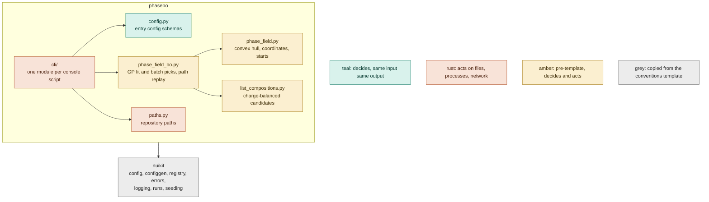
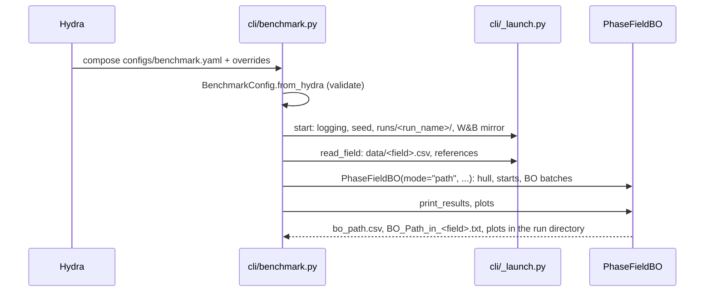

# Contributing

How phasebo is built and how to change it. Using it: [README.md](README.md). Conventions that apply to every project,
with their reasons: [CONVENTIONS.md](CONVENTIONS.md) (a read-only copy of the guide; `copier update` refreshes it).
The `conventions-reviewer` subagent in `.claude/agents/` checks a branch or the repo against it.

## Architecture



`phasebo` holds this project's code and nothing else. The three amber modules predate the template: they compute
and write files in the same classes, so they have no pure half yet. They are rewritten into families (data,
surrogate, acquisition, starting set, policy, metric) and then removed; until then the commands call them directly.

`nuikit` is the machinery every project built from the template shares: what schemas and families build on, and
what an entry point sets up before it runs. Copier writes it; fixes go upstream and arrive with `copier update`.

Dependencies point down: `cli` > `config` > `phase_field_bo` > `phase_field` | `list_compositions` > `paths`, and any
layer may import `nuikit`. The import-linter contracts in `pyproject.toml` enforce the order and keep `nuikit` from
importing `phasebo`. The layers contract is exhaustive, so a new subpackage fails `make check` until it is placed in
`layers`.

### A command



## Repository layout

```text
configs/                  Hydra YAML; generated files say so in their first line
  suggest.yaml            entry configs: pick the mirror, the phase field and Hydra's settings
  benchmark.yaml
  generate.yaml
  defaults/               every setting of each entry config with its default (generated)
  system/LiSnSCl.yaml     a phase field: data file, references, ions, candidate space
  hydra/default.yaml      Hydra writes nothing; the app writes runs/
data/                     published datasets, tracked (see Deviations)
src/phasebo/
  cli/                    one module per console script, plus _launch.py, their shared start-up
  config.py               entry config schemas + GENERATED (files `make configs` writes)
  paths.py                repository paths, from the .project-root marker
  phase_field.py          pre-template: hull, coordinates, starting compositions
  phase_field_bo.py       pre-template: BoTorch GP, batch picks, replay, result files
  list_compositions.py    pre-template: candidate generation
src/nuikit/               copied from the conventions template: config, configgen, registry, errors, logging,
                          runs, seeding
tests/                    mirrors src/; tests/nuikit/ comes with the template
  test_invariants.py      configs compose and are fresh, kinds build, import layers hold
  phasebo/                tests of the new modules
  test_phase_field*.py    pre-template tests, with conftest.py's synthetic phase fields
  integration/            end to end, `-m integration`
scripts/                  one-off runnables, never imported; reused or tested ones become cli/ commands
notebooks/                exploration only, outputs stripped; reference/ for third-party notebooks
runs/                     gitignored
```

## Families

None yet. The rewrite of the pre-template modules adds them: a family is a concept with several implementations
chosen by a config `kind`.

```text
src/phasebo/<family>/
  base.py        <Family> (attrs ABC), <Family>Config, <Family>Factory (config_group = "<family>")
  items/
    __init__.py  import_submodules(__name__)
    <kind>.py    @<Family>Factory.register("<kind>") above @define
```

`<Family>Factory.from_config({"kind": ..., ...})` validates against the item's config and builds it; `make configs`
writes `configs/<family>/kinds/<kind>.yaml`.

## Extending

| to add | create | and |
|---|---|---|
| a phase field | its CSV in `data/` and `configs/system/<name>.yaml` | run with `system=<name>` |
| a family | `src/phasebo/<family>/base.py` + `items/` | place it in the import-linter `layers`; `make configs` |
| an item | `src/phasebo/<family>/items/<kind>.py` | `make configs` |
| an entry config | a schema in `config.py` listed in `GENERATED` as `defaults/<command>.yaml`, and `configs/<command>.yaml` composing it | a `cli/<command>.py` and a console script |
| a setting | a `Field(default=..., description=...)` on the schema | `make configs` |

## Deviations

- **Pre-template modules** (`phase_field.py`, `phase_field_bo.py`, `list_compositions.py`, and their tests
  `tests/conftest.py`, `tests/test_phase_field.py`, `tests/test_phase_field_bo.py`) are excluded from ruff, pyright
  and pre-commit. They break TYP-4 (no attrs, `__init__` runs the whole computation), ARC-2 (no pure half), RUN-2
  (global `random`), LOG-2 (f-string events) and STY-8 (non-ASCII). Making them pass would be thrown away: the
  `refactor/data` and `feat/bo-families` branches replace them, then drop these exclusions. The new command tests
  use the `li_sn_s_cl` fixture of `tests/conftest.py`, so the rewrite moves that fixture rather than deleting it.
- **`data/` is tracked** (RUN-6 says gitignored). The datasets are small and published with the paper, and every
  number in the docs must trace back to the exact file; pre-commit's whitespace fixers leave them byte for byte.
- **Notebooks are marimo files** (RUN-5 describes `.ipynb`), installed with the `notebooks` dependency group. They
  are plain Python with no stored outputs, so nbstripout has nothing to strip; `__marimo__/` caches are gitignored.
- **`cli/_launch.py`** is a module in `cli/` that is not a console script (LAY-7). The three Hydra commands share
  their start-up steps, which need the config schemas, so they sit in the only layer above `config`.

## Tests

```bash
make test               # unit tests, a few seconds
make test-integration   # end to end, behind the integration marker
```

Fakes, not mocks (`unittest.mock` is banned by ruff). Each case covers a distinct behaviour; child processes and
servers only for what cannot be measured in process. The commands are tested through their `run(cfg, runs_dir=...)`
functions; `tests/test_invariants.py` covers their Hydra configs.

## Commits

Conventional Commits with the standard types (`feat fix docs refactor test build ci perf style chore revert`), an
optional scope, a lowercase imperative subject: one line, no articles, no body or trailers. Short-lived `<type>/<slug>`
branches, squash-merged. The commit-msg hooks check all of it. PR descriptions follow
`.github/pull_request_template.md`; `make github`, run once per repo, makes the squash commit the PR title alone.
